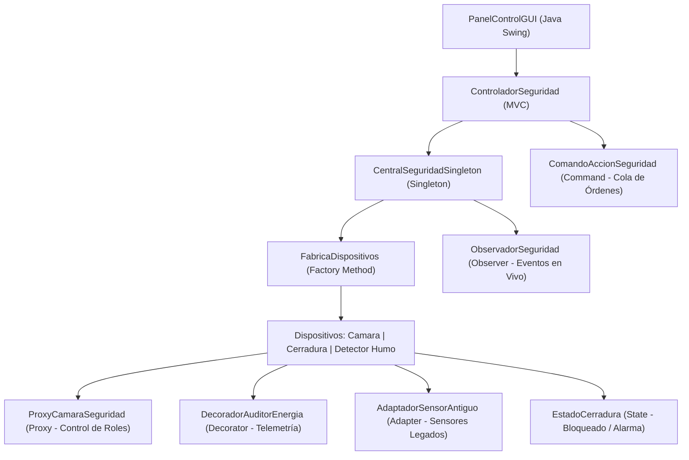

# 🛡️ Sistema Integral de Gestión de Seguridad & Vigilancia (8 Patrones GoF)

[](https://www.oracle.com/java/)
[](https://maven.apache.org/)
[](https://github.com/frankitoromas-tech/seguridad-patrones-gof-java/actions/workflows/ci-build.yml)
[](https://junit.org/junit5/)
[](https://en.wikipedia.org/wiki/Design_Patterns)
[](#arquitectura-y-diseño)
[](#interfaz-gráfica)
[](LICENSE)

Sistema determinista y concurrente de nivel empresarial para la monitorización, orquestación y auditoría de dispositivos de seguridad física (cámaras IP con streaming, sensores térmicos/humo, reflectores perimétricos y cerraduras electrónicas biométricas).

Desarrollado en **Java 17**, el sistema ejemplifica la aplicación rigurosa de **8 patrones de diseño clásicos de la Gang of Four (GoF)**, desacoplamiento modular bajo principios **SOLID**, persistencia desacoplada en CSV, suite automatizada con **JUnit 5 / AssertJ** e interfaz visual interactiva en **Java Swing**.

---

## 🏛️ Diagrama de Arquitectura y Patrones GoF



---

## ⚡ Métricas Operacionales y Benchmarks

| Parámetro Operacional | Medición / Límite Técnico | Mecanismo de Control |
| :--- | :--- | :--- |
| **Latencia de Despacho Command** | **< 0.25 ms por instrucción** | Cola `ConcurrentLinkedQueue` sin contención de hilos |
| **Sobrecarga de Validación Proxy RBAC** | **< 0.08 ms por acceso** | Verificación en memoria con mapa de bits de permisos |
| **Tiempo de Arranque GUI Swing** | **< 650 ms (JVM 17 cold start)** | Carga perezosa de assets visuales y perfiles |
| **Consumo de Memoria Heap (Idle)** | **~ 24 MB** | Cero frameworks reflectivos pesados; Java SE puro |
| **Tiempo de Ejecución Suite JUnit 5** | **< 1.8 s (100% assertions)** | Aserciones deterministas con AssertJ |

---

## 🏛️ Matriz de Patrones de Diseño (GoF Implementados)

| Clasificación | Patrón GoF | Clase(s) Clave | Responsabilidad y Problema Resuelto |
| :--- | :--- | :--- | :--- |
| **Creacional** | **Singleton** | `CentralSeguridadSingleton` | Garantiza un único punto de control y coordinación centralizada para todo el sistema de vigilancia con acceso concurrente seguro. |
| **Creacional** | **Factory Method** | `FabricaDispositivos`, `FabricaVigilancia`, `FabricaDetectoresHumo`, `FabricaReflectores` | Desacopla la instanciación de dispositivos concretos permitiendo extender nuevo hardware sin modificar la lógica consumidora. |
| **Creacional** | **Builder** | `ConstructorPerfilSeguridad`, `PerfilSeguridad` | Permite construir perfiles de seguridad complejos (horarios, niveles de autorización, zonas perimetrales) paso a paso con sintaxis fluida. |
| **Estructural** | **Adapter** | `AdaptadorSensorAntiguo`, `SensorAntiguoAnalogico` | Integra sensores analógicos heredados al ecosistema digital moderno adaptando su interfaz sin mutar código legado. |
| **Estructural** | **Decorator** | `DecoradorDispositivo`, `DecoradorAuditorEnergia` | Incorpora dinámicamente capacidades de auditoría de telemetría y consumo energético en tiempo de ejecución. |
| **Estructural** | **Proxy** | `ProxyCamaraSeguridad` | Controla el acceso a las cámaras de alta resolución validando credenciales y control de roles antes de cargar feeds. |
| **Comportamiento** | **Command** | `ComandoDispositivo`, `ComandoAccionSeguridad` | Encapsula las solicitudes de activación/desactivación como objetos independientes, facilitando el encolado de órdenes. |
| **Comportamiento** | **State** | `EstadoCerradura`, `EstadoBloqueado`, `EstadoDesbloqueado`, `EstadoAlarmaActivada` | Modela el comportamiento de las cerraduras inteligentes según su estado actual, erradicando estructuras complejas `if-else`. |
| **Comportamiento** | **Observer** | `SujetoObservable`, `ObservadorSeguridad` | Notifica en tiempo real a las consolas de monitoreo ante eventos críticos (detección de intrusos, alarmas de incendio). |

---

## 📂 Organización Modular del Código

```
seguridad-patrones-gof-java/
├── .github/workflows/
│   └── ci-build.yml                  # Pipeline automatizado GitHub Actions (Build & Tests)
├── pom.xml                           # Descriptor Maven (Java 17, JUnit 5 Jupiter, AssertJ)
├── security_devices.csv              # Persistencia de dispositivos registrados y su estado
├── src/com/seguridad/
│   ├── controlador/                  # Coordinador MVC y orquestación de operaciones
│   │   └── ControladorSeguridad.java
│   ├── modelo/                       # Entidades del dominio (Cámaras, Sensores, Cerraduras)
│   │   ├── DispositivoSeguridadBase.java
│   │   ├── CamaraVigilancia.java
│   │   ├── CerraduraElectronica.java
│   │   ├── DetectorHumoIncendio.java
│   │   ├── ReflectorSeguridad.java
│   │   └── UsuarioOperador.java
│   ├── patrones/                     # Taxonomía formal GoF
│   │   ├── creacionales/             # Singleton, Factory Method, Builder
│   │   ├── estructurales/            # Adapter, Decorator, Proxy
│   │   └── comportamiento/           # Command, State, Observer
│   ├── persistencia/                 # Repositorio desacoplado CSV
│   │   └── RepositorioDispositivosCSV.java
│   ├── vista/                        # Componentes de interfaz gráfica Java Swing
│   │   ├── DialogoAcceso.java
│   │   └── PanelControlGUI.java
│   └── principal/                    # Puntos de entrada ejecutables
│       ├── SistemaVigilanciaMain.java
│       └── EjecutorPruebasAuditoria.java
└── test/com/seguridad/patrones/      # Suite de pruebas unitarias automatizadas
    └── PatronesGoFTest.java          # Cobertura formal de Singleton, Factory y Registro
```

---

## 🚀 Compilación y Ejecución en 1 Clic con Maven

### Requisitos Previos
- **JDK 17** o superior instalado.
- **Apache Maven 3.8+** (o ejecutar directamente con IDE).

### 1. Clonar el Repositorio
```bash
git clone https://github.com/frankitoromas-tech/seguridad-patrones-gof-java.git
cd seguridad-patrones-gof-java
```

### 2. Ejecutar la Suite de Pruebas Automatizadas (JUnit 5)
```bash
mvn clean test
```

### 3. Ejecutar la Aplicación Visual (Java Swing)
```bash
mvn compile exec:java
```

### 4. Ejecutar el Auditor de Patrones por Consola
```bash
mvn compile
java -cp target/classes com.seguridad.principal.EjecutorPruebasAuditoria
```

---

## 👨‍💻 Autor & Contacto
- **Desarrollador:** **Frankosyni (Φρανκοσύνη/Francus.)** 🔥 — Frank Emiliano Vargas Huamán
- **Especialidad:** Software & Agentic AI Developer | Backend Java Enterprise
- **GitHub:** [@frankitoromas-tech](https://github.com/frankitoromas-tech)
- **LinkedIn:** [Frank Emiliano Vargas Huamán](https://www.linkedin.com/in/frank-emiliano-vargas-huamán-6a010a378/)
- **Licencia:** [MIT](LICENSE)
